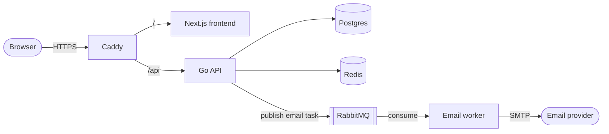

# Agropal

A farm management app for small growers: products and stock, orders, weather, a crop calendar and a discussion board.

**Live demo:** <!-- TODO: replace with the deployed URL -->https://agropal.dev/#demo (no account needed, nothing is saved)

 


| | |
| --- | --- |
|  |  |

---

## Stack and testing

- **Backend:** Go with the standard library router, PostgreSQL with versioned migrations, Redis, RabbitMQ. The API is documented in [`backend/docs/openapi.yaml`](backend/docs/openapi.yaml).
- **Frontend:** Next.js and TypeScript.
- **Tests:** unit tests plus integration tests that run against real PostgreSQL, Redis and RabbitMQ containers. CI runs build, vet, gofmt and the race detector on every push.

## Tests

The Go backend has unit and integration tests. The integration tests start real Postgres, Redis and RabbitMQ
containers with testcontainers, so Docker must be running.

```sh
cd backend
go test ./... -race -count=1 -coverprofile=coverage.out
go tool cover -func=coverage.out | tail -1    # total
go tool cover -html=coverage.out              # per-line report in the browser
```

Backend statement coverage is **about 65%** overall (measured October 2026). The business-logic and HTTP layers sit
mostly between 70% and 95%; the lower overall figure comes from untested wiring: the `cmd/` entrypoints, the container,
the email sender and the database and queue connection helpers. The frontend has no automated tests yet; CI runs
lint, type checking and a production build on it.

---

## Architecture



- **Caddy** terminates HTTPS and serves the app and the API from one origin.
- **API** (Go) owns the business logic and stores its data in **Postgres**; **Redis** holds the short-lived email verification codes.
- Sign-in and password-reset emails are queued on **RabbitMQ** and sent by a separate **worker**, so a slow mail provider never blocks a request.


<!--
## Decisions I made

- **Go with no web framework.**
I chose Go for its performance and its strict typing, which catches mistakes at compile time instead of in production. The API uses the standard library's `net/http` router and no web framework, because the standard library already does what this project needs and means fewer dependencies to maintain and understand.

- **A queue and a worker for email, not sending inline.**
I've seen what happens when an app sends email inside the request. The request took almost 10 seconds, because each email had to finish sending before the next one could start. In AgroPal the API publishes a task to RabbitMQ and returns straight away, and a separate worker sends the email. Sign-in stays fast even when the mail provider is slow, and the worker can be restarted or scaled without touching the API.

- **Redis for verification codes.**
One-time sign-in codes are short lived, so they belong in a store with built-in expiry. Codes expire after 10 minutes, there's a 60 second cooldown before another can be requested, and only a SHA-256 hash of the code is stored, so someone reading the cache can't read live codes. I also chose Redis now because I plan to add idempotency keys for safe request retries, and having it in the stack already makes that easier.

- **Caddy as the single entry point.**
Caddy sits in front of the app and the API on one domain, serves everything over HTTPS, and gets and renews its own certificates automatically. One origin also keeps the sign-in cookie first-party, so the API needs no CORS setup in production. Only ports 80 and 443 are open to the internet.

- **Next.js for the frontend.**
  Routing comes from the folder structure and the build pipeline is already configured, so there's less setup than a plain React project. It was also a good reason to learn a framework I hadn't used before.
-->

---

## Run everything

```sh
cp .env.example .env      # then change the passwords and secrets
docker compose up --build
```

| What | Where |
| --- | --- |
| App | http://localhost:3000 |
| API | http://localhost:8080/api/v1 |
| Sign-in emails (mail catcher) | http://localhost:8025 |

Signing in sends a one-time code by email. With the default setup nothing is really sent: open the mail
catcher and copy the code from there.

Stop with `docker compose down`; add `-v` to also delete the database.

## Things to know

- The API allows browser calls from the origins in `backend/config/config.yaml` (`cors.allowed_origins`,
  `http://localhost:3000` by default). Change it if you serve the app from another address.
- `NEXT_PUBLIC_*` settings are baked into the frontend image when it is built, so rebuild after changing them.
- The sign-in cookie is `Secure`. Browsers accept that on `localhost`; anywhere else the app needs HTTPS, and
  the app and API must share a registrable domain (for example `app.example.com` and `api.example.com`).
- This stack has no real email: sign-in codes go to the mail catcher. For real email use the production setup below, which takes `SMTP_*` and `SECRET_SMTP` from `.env`.

## Deploy to a server

`docker-compose.prod.yaml` runs the same stack behind Caddy, which serves the app and the API from one HTTPS
origin (`/` is the frontend, `/api` is the API) and renews its certificate by itself. Only ports 80 and 443 are
published, and there is no mail catcher, so a real SMTP provider is required.

```sh
cp .env.prod.example .env      # set DOMAIN, passwords, secrets (openssl rand -hex 32) and SMTP_*
docker compose -f docker-compose.prod.yaml up -d --build
```

Point the domain's DNS A record at the server first. About 2 vCPU and 4 GB RAM is comfortable; 2 GB works with
swap, building one image at a time. The API
reports liveness at `/healthz` and refuses to start with a JWT or GCM secret under 32 characters.

Pushes to `main` deploy through `.github/workflows/deploy.yml`, which logs in to the server over SSH, pulls the code and
rebuilds the containers. First-time server setup (firewall, Docker, deploy key, GitHub secrets, swap, backups) is in
[`docs/deploy-server-setup.md`](docs/deploy-server-setup.md). Tests and linting run in `backend.yml` and `frontend.yml`
on pull requests and pushes.
