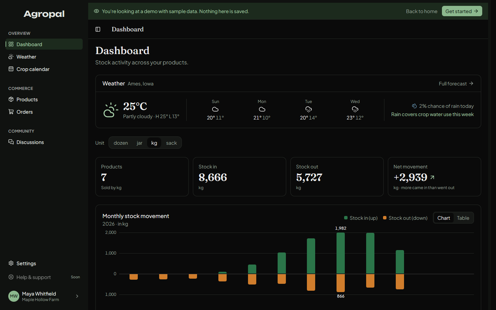
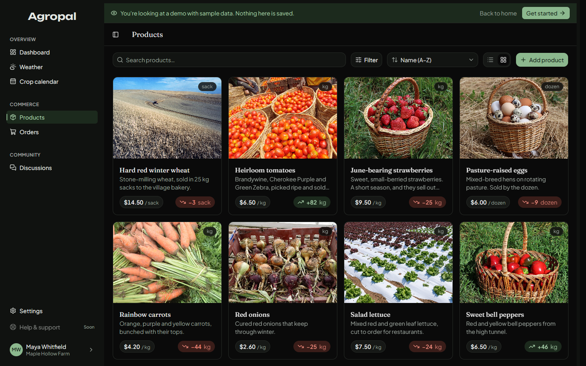
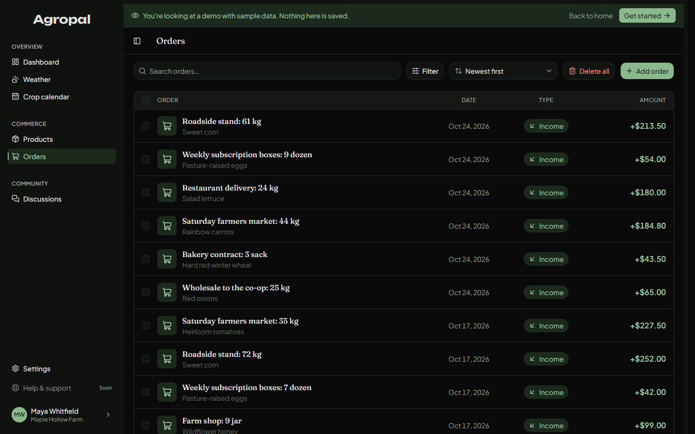
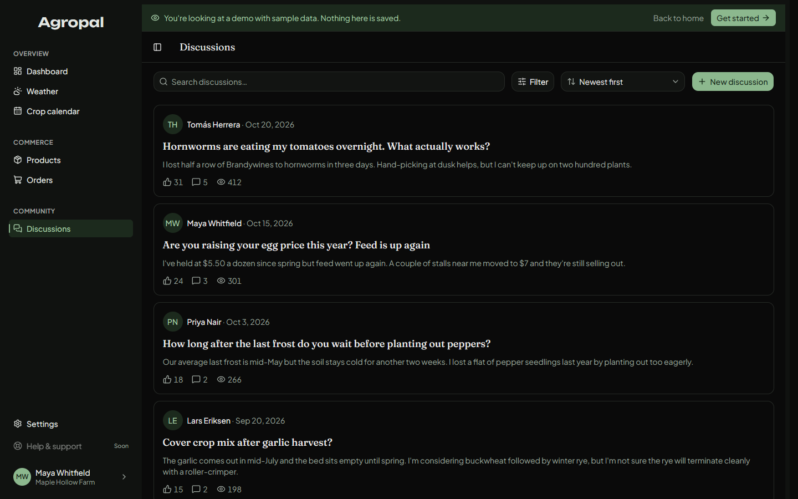
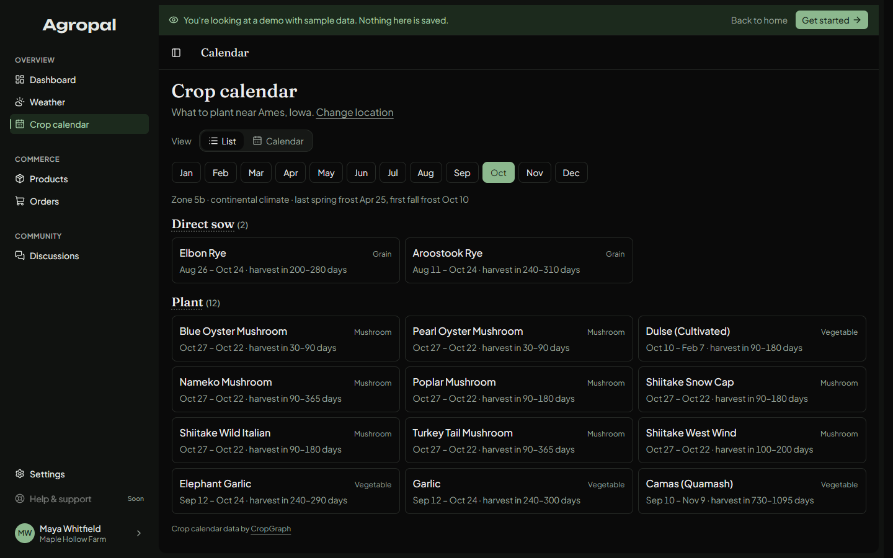
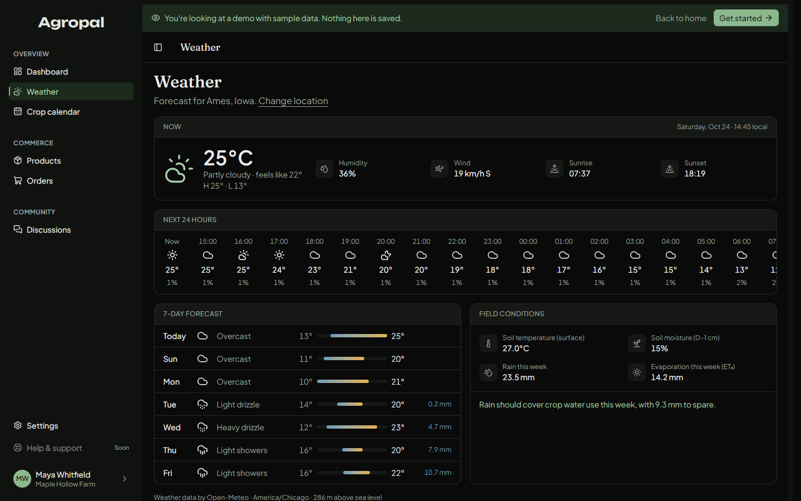
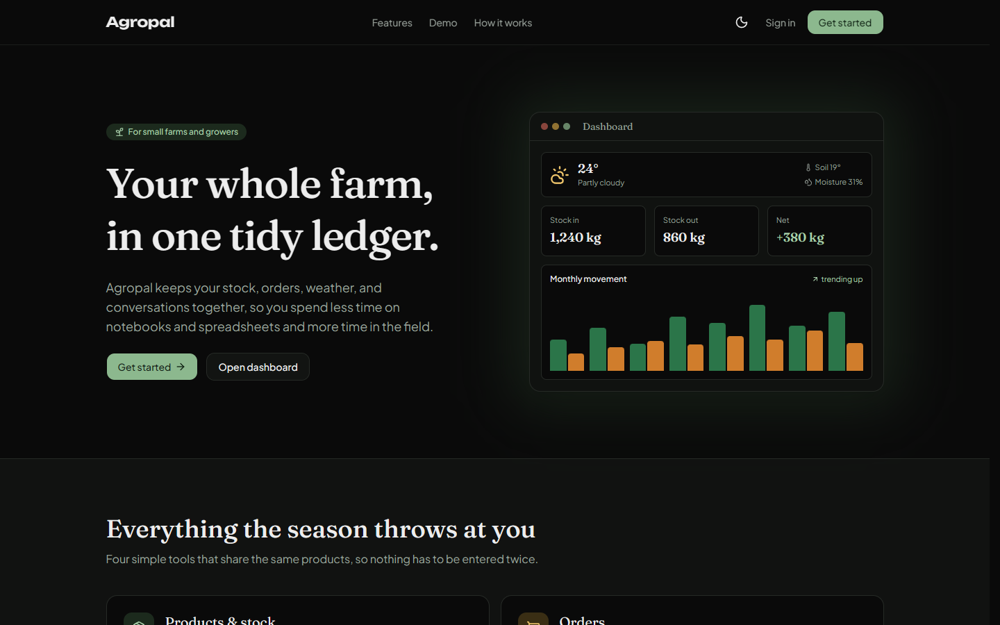
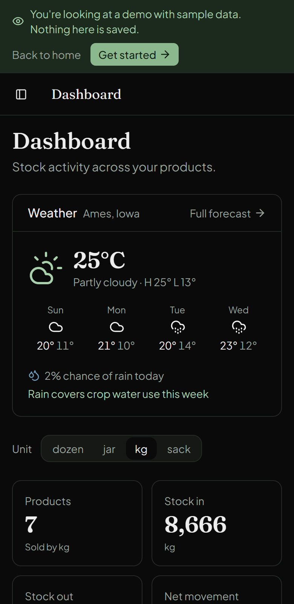
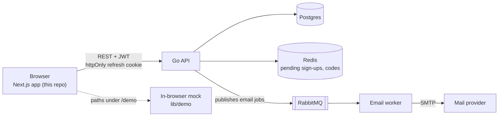

# Agropal

A farm management app: track products and their stock, record orders, check the weather for your fields, plan a
crop calendar, and talk to other growers. This folder is the web app (Next.js). The REST API it talks to
(Go, Postgres, Redis, RabbitMQ) is in `../backend`.

**Try it without an account:** open `/demo` (for example http://localhost:3000/demo). It shows a farm that has
been used for a while, with sample data and stock photos, and nothing you do there is saved.



| | |
| --- | --- |
|  |  |
|  |  |
|  |  |

The layout adapts down to a phone:



## What it does

- **Dashboard**: stock in, stock out and net movement per unit, a monthly chart (with a table view), and a weather summary.
- **Products**: list or grid, search, filter, sort, price and stock history per product.
- **Orders**: record and bulk-add stock in and out, with filters shared through the URL.
- **Discussions**: posts, threaded replies, reactions, and filtering by author or search.
- **Weather and crop calendar**: forecast for the farm's location (picked on a map), and a planting calendar (what to plant now, with frost dates) from the free CropGraph API, which covers the US only.
- **Accounts**: sign-up and sign-in confirmed by an emailed one-time code, password reset, profile, farm name and password settings, account deletion.

## How it's built



- **Next.js 16, React 19, Tailwind 4, Base UI.** The app uses the App Router with `cacheComponents` and builds as a
  standalone Docker image.
- **Route groups** split the app by audience: `(marketing)` is the landing page, `(auth)` is sign-in and
  registration, `(app)` is the signed-in product, and `(demo)` is the public sample.
- **Data layer** (`lib/api`): a small typed client keeps the access token in memory and lets the server's httpOnly
  cookie renew it. `resources.ts` maps API responses to the app's types, and `use-query.ts` is a tiny cache with
  invalidation after writes.
- **Demo mode is the same app.** The `/demo/*` pages wrap the real pages. While the URL starts with `/demo`, the API
  client answers from `lib/demo` (seeded sample data) instead of the network, links are prefixed with `/demo`, and
  every write returns a friendly "this is a demo" message. That keeps the demo from drifting away from the real UI.
- **Responsive by container, not window.** Tables and cards use Tailwind container queries, because the sidebar
  takes a quarter of a small window and the page width says little about the room a component has.

```
app/
  (marketing)/   landing page
  (auth)/        sign-in, registration, one-time code
  (app)/         dashboard, products, orders, discussions, weather, calendar, settings
  (demo)/demo/   public sample of the same pages
components/      shared UI (ui/ holds the primitives)
lib/api/         client, resources, hooks, query cache
lib/auth/        session provider
lib/demo/        sample data and the in-browser mock API
```

## Run it

You need Node 22.

```sh
npm install
npm run dev
```

Open http://localhost:3000. The landing page and `/demo` work with no backend at all.

To sign in for real, start the API (`../backend/README.md` covers it, or from the repo root run
`docker compose up --build api email-worker`, which also starts its databases and the mail catcher), then create `.env.local`:

```sh
NEXT_PUBLIC_API_URL=http://localhost:8080/api/v1   # the default
NEXT_PUBLIC_MAPBOX_TOKEN=pk.…                      # optional: the location picker map
```

`NEXT_PUBLIC_*` values are baked into the bundle at build time, so rebuild after changing them.

| Command | What it does |
| --- | --- |
| `npm run dev` | Dev server |
| `npm run build` | Production build |
| `npm run lint` | ESLint |
| `npx tsc --noEmit` | Type check |

CI (`.github/workflows/frontend.yml` at the repo root) runs lint, the type check and a production build on pushes to `main` and on pull requests that touch `frontend/`. Production deploys are a separate workflow, `deploy.yml`.

## Photo credits

Demo photos come from Wikimedia Commons under free licences. Authors and licences are listed in
[`public/demo/CREDITS.md`](public/demo/CREDITS.md).
